<p align="center">
  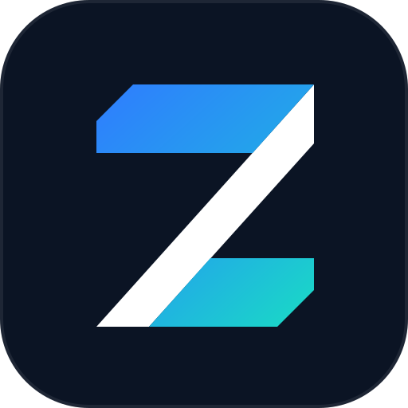
</p>

<h1 align="center">Zepp Cloud MCP</h1>

<p align="center">
  <b>Your Amazfit / Zepp health and workout data for ChatGPT, Claude and Cursor, through a read-only MCP server that you host yourself. Comes with a dashboard.</b>
</p>

<p align="center">
  <a href="LICENSE"></a>
  
  
  
  <a href="https://github.com/aryarfani/zepp-cloud-mcp/actions/workflows/ci.yml"></a>
</p>

<p align="center">
  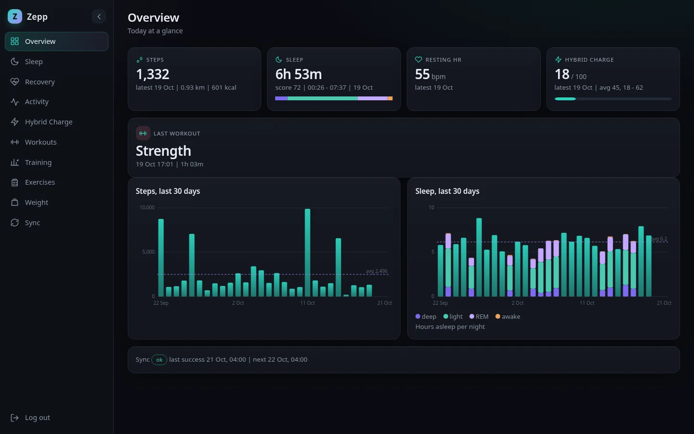
</p>

> **Unofficial.** This project is not affiliated with, endorsed by, or supported by Zepp Health, Huami or Amazfit. It uses Zepp's private, undocumented cloud API, which can change or break at any time.

## Why

Amazfit watches send a lot of data to Zepp Cloud: sleep stages, HRV, readiness, training load, strength sets, GPS routes. The Zepp app is the only place you can see it. Zepp Cloud MCP reads that data with your own app token, turns it into clean typed JSON, and serves it over the [Model Context Protocol](https://modelcontextprotocol.io). You can then ask an assistant questions like *"how did my sleep change after I started lifting in the evening?"*. The self-hosted Node server can also sync the data into a local SQLite database and show it on a private web dashboard.

## Features

- **19 read-only MCP tools** for daily summary, sleep, heart rate, recovery (HRV, readiness, stress, SpO2), training status (load, VO2max), workouts, per-workout samples, GPS routes, strength sets, weight, blood pressure, Hybrid Charge, emotion/stress events and sync status.
- **Long ranges.** Date ranges up to 366 days. Ranges longer than Zepp's 31-day window are split into several upstream requests and merged.
- **Strength training.** Set-by-set exercises, reps, weight and volume, mapped to primary and secondary muscle groups.
- **Two deployment targets:**
  - **Node server** (VPS, home server) with an OAuth 2.1 authorization server, a dashboard, and a daily SQLite sync.
  - **Cloudflare Worker**: stateless, with a static bearer token and no database.
- **OAuth 2.1 for remote connectors.** Single owner, dynamic client registration, PKCE (S256), refresh tokens and token revocation. Works with ChatGPT and Claude custom connectors.
- **Dashboard.** Overview, Sleep, Recovery, Activity, Hybrid Charge, Workouts (with muscle map and OpenStreetMap route map), Training, Exercises, Weight and Sync pages, plus GPX/TCX export. The layout is responsive and works on phones.
- **Safe by design.**
  - No arbitrary upstream URLs.
  - The region host is validated against Zepp/Huami origins before any credentials are attached.
  - Raw payloads are sanitized.
  - Secrets come only from the environment.

## Screenshots

| | |
|---|---|
| 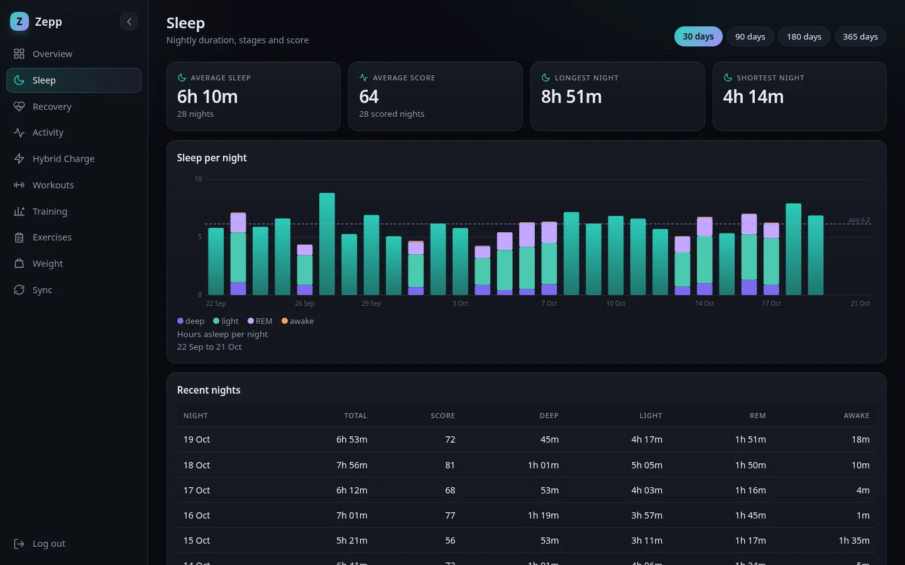 **Sleep**: nightly stages and recent nights | 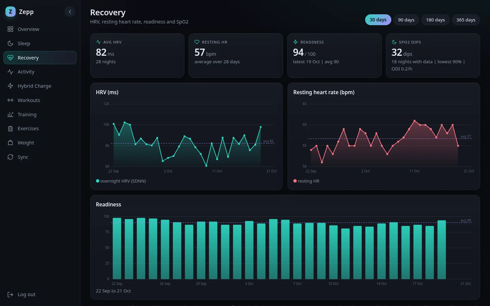 **Recovery**: HRV, resting HR, readiness |
| 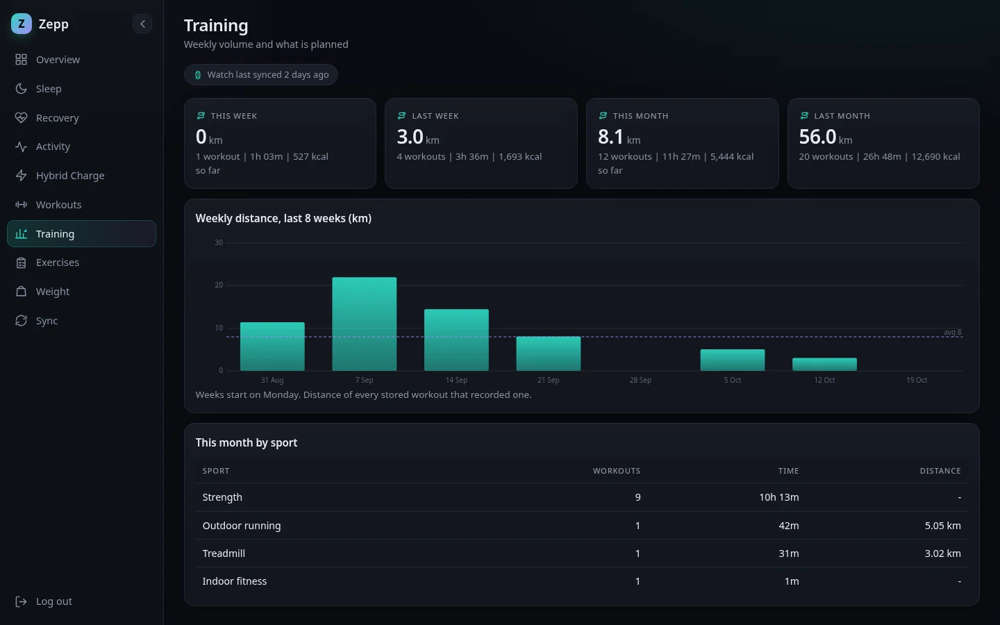 **Training**: weekly distance and load by sport | 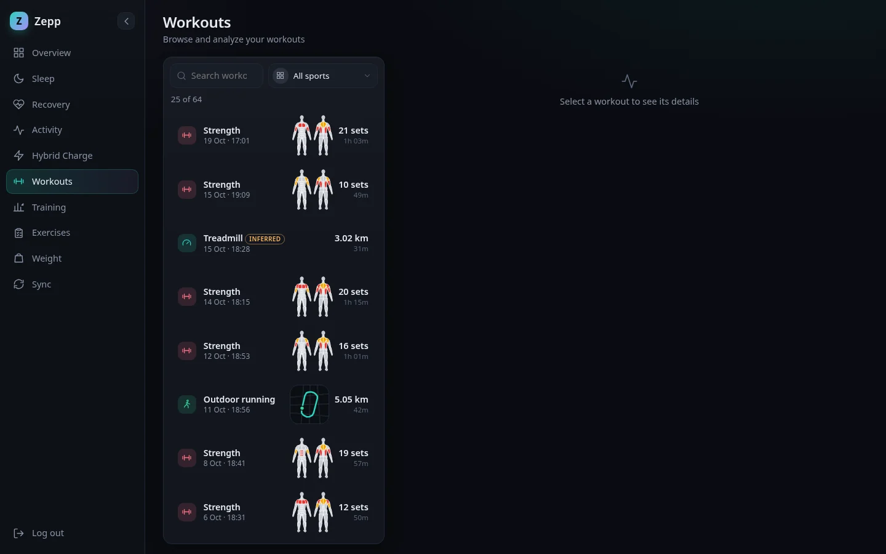 **Workouts**: searchable list with muscle thumbnails |
| 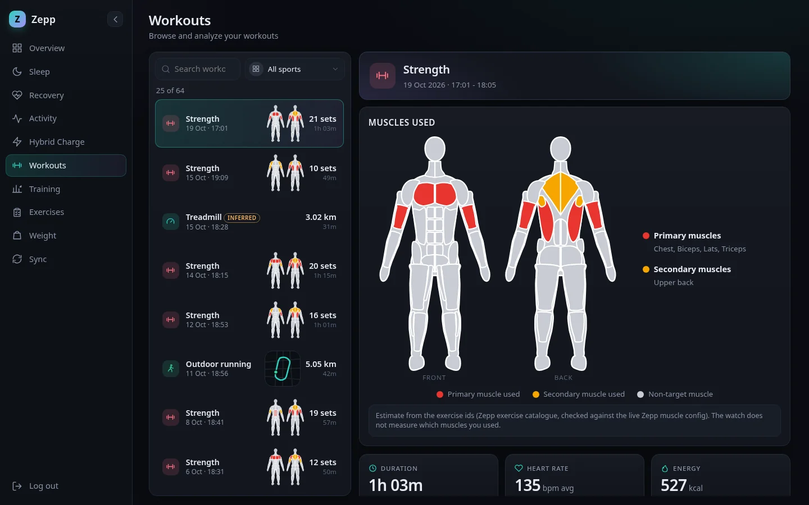 **Strength detail**: muscles worked, sets, volume | 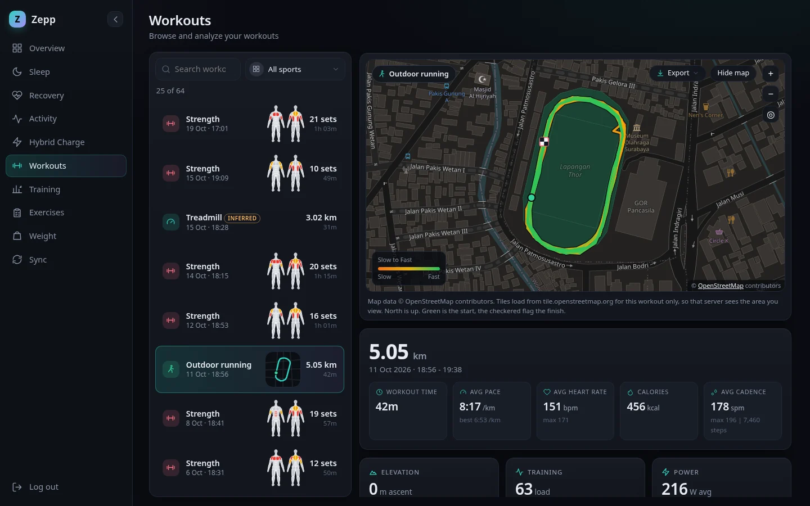 **Run detail**: OpenStreetMap route, pace, HR |
| 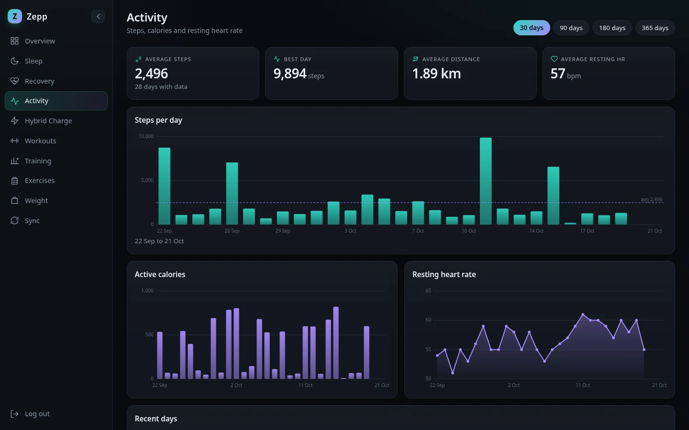 **Activity**: steps, calories, resting HR | 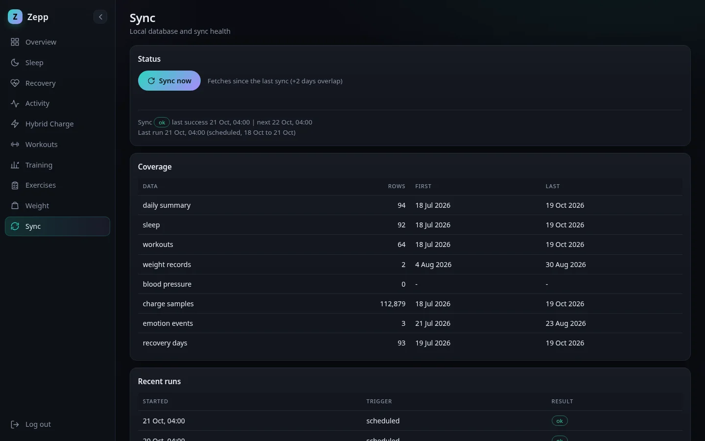 **Sync**: local database coverage and run history |

<p align="center">
  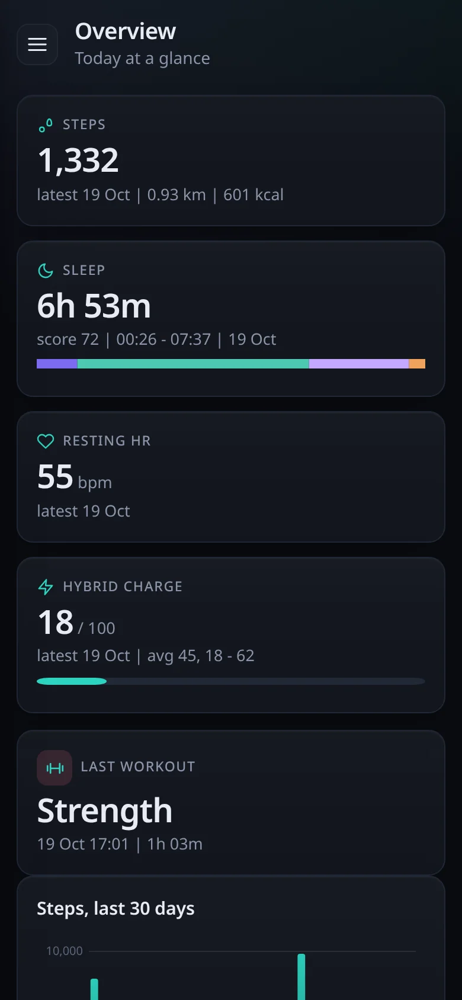
  &nbsp;
  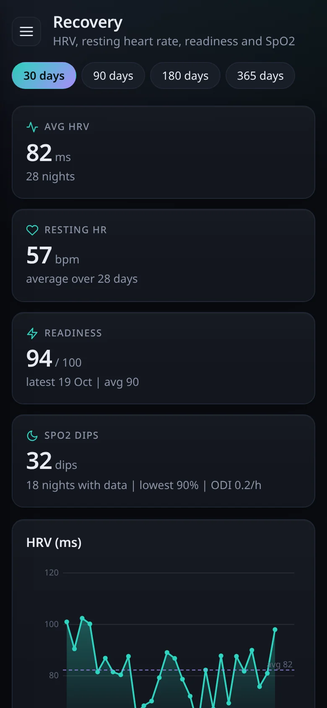
</p>

## Quick start (Node server)

Requirements:

- Node.js **22.5 or later**. The sync store uses the built-in `node:sqlite`.
- A Zepp app token, your Zepp user ID and your regional API host. See [docs/ZEPP_AUTH.md](docs/ZEPP_AUTH.md).

```bash
git clone https://github.com/aryarfani/zepp-cloud-mcp.git
cd zepp-cloud-mcp
npm ci
cp .dev.vars.example .env   # then edit .env (see the table below)
npm start                   # listens on http://127.0.0.1:8788
```

Check that it is running:

```bash
curl http://127.0.0.1:8788/health
```

To fill the local database right away instead of waiting for the daily sync, run:

```bash
npm run sync -- --days 30
```

### Configuration

The Node server reads `.env` (via `dotenv`) and the process environment.

| Variable | Required | Default | Description |
|---|---|---|---|
| `MCP_SECRET` | yes | (none) | Static bearer token accepted on `/mcp`. Use a long random value. |
| `ZEPP_APP_TOKEN` | yes | (none) | Zepp `apptoken`. Never commit it. |
| `ZEPP_USER_ID` | yes | (none) | Numeric Zepp user ID. |
| `ZEPP_REGION_HOST` | yes | (none) | Bare HTTPS origin such as `https://api-mifit-us3.zepp.com`. Must be a Zepp/Huami `api-mifit*` host. |
| `USER_TIMEZONE` | no | `Asia/Jakarta` | IANA zone used to turn local dates into day boundaries. |
| `PORT` | no | `8788` | Port to listen on. The server always binds to `127.0.0.1`. |
| `OAUTH_OWNER_PASSWORD` | no | (none) | At least 16 characters. Turns on the OAuth 2.1 server **and** the dashboard login. If it is missing, only the static bearer works. |
| `OAUTH_STORE_PATH` | no | `data/oauth-store.json` | Where OAuth clients and tokens are stored. |
| `OAUTH_ISSUER` | no | from request | Public base URL, for example `https://zepp.example.com`. |
| `DASHBOARD_SESSION_SECRET` | no | derived from owner password | Session signing key, 32 characters or more. |
| `SYNC_ENABLED` | no | `true` | Run the daily sync. |
| `SYNC_HOUR` | no | `4` | Local hour (0 to 23) for the daily sync. |
| `SYNC_BACKFILL_DAYS` | no | `90` | Days fetched on the first run (max 730). |
| `SYNC_RECENT_DAYS` | no | `7` | Minimum window for incremental syncs (capped by the 31-day smart window). |
| `SYNC_OVERLAP_DAYS` | no | `2` | Days re-fetched before the last successful sync. |
| `SYNC_REQUEST_DELAY_MS` | no | `400` | Delay between upstream requests. |
| `ZEPP_DB_PATH` | no | `data/zepp.db` | SQLite database file. |

## Deploy

### Option A: Node server behind nginx (systemd)

`/etc/systemd/system/zepp-mcp.service`:

```ini
[Unit]
Description=Zepp Cloud MCP
After=network-online.target

[Service]
WorkingDirectory=/opt/zepp-cloud-mcp
ExecStart=/usr/bin/npx tsx src/server-node.ts
Restart=on-failure
User=zepp
# Secrets live in /opt/zepp-cloud-mcp/.env (chmod 600)

[Install]
WantedBy=multi-user.target
```

nginx (TLS through certbot or similar):

```nginx
server {
  server_name zepp.example.com;
  location / {
    proxy_pass http://127.0.0.1:8788;
    proxy_http_version 1.1;
    proxy_set_header Host $host;
    proxy_set_header X-Forwarded-Proto $scheme;
    proxy_buffering off;          # streamable HTTP
    proxy_read_timeout 300s;
  }
  listen 443 ssl;
}
```

```bash
sudo systemctl enable --now zepp-mcp
```

You get these endpoints:

- `/mcp`: MCP over Streamable HTTP.
- `/dashboard`: the web dashboard.
- `/authorize`, `/token`, `/register`, `/revoke`: OAuth.
- `/.well-known/oauth-authorization-server` and `/.well-known/oauth-protected-resource`: OAuth discovery metadata.
- `/health`: health check.

### Option B: Cloudflare Workers (stateless)

The Worker (`src/index.ts`) serves `/mcp` with the static `MCP_SECRET` bearer only. It has no OAuth, no dashboard, no sync, and no `sync_status` tool, so it exposes 18 tools.

```bash
npm ci
npx wrangler login
# edit wrangler.jsonc vars: ZEPP_USER_ID, ZEPP_REGION_HOST, USER_TIMEZONE
npx wrangler secret put ZEPP_APP_TOKEN
npx wrangler secret put MCP_SECRET
npm run deploy
```

See [docs/DEPLOY.md](docs/DEPLOY.md) for details.

## Connecting a client

| Client | How |
|---|---|
| **ChatGPT** | Settings → Apps & Connectors → Create (developer mode). URL `https://zepp.example.com/mcp`, auth **OAuth**. Sign in with the owner password when asked. |
| **Claude** | Settings → Connectors → Add custom connector. URL `https://zepp.example.com/mcp`. Claude registers itself through dynamic client registration and sends you to the owner login. |
| **Cursor** | Add the server to `~/.cursor/mcp.json` with a bearer header, as shown below. |

```json
{
  "mcpServers": {
    "zepp": {
      "url": "https://zepp.example.com/mcp",
      "headers": { "Authorization": "Bearer YOUR_MCP_SECRET" }
    }
  }
}
```

More detail is in [docs/MCP_SETUP.md](docs/MCP_SETUP.md).

## MCP tools

All tools are read-only. Each call fetches live from Zepp Cloud; only `sync_status` reads the local database. Dates are local `YYYY-MM-DD` in `USER_TIMEZONE`.

| Tool | What it returns |
|---|---|
| `zepp_status` | Checks auth and upstream reachability. Returns no health values. |
| `get_daily_summary` | One day's steps, distance, calories, resting HR and other daily fields |
| `get_sleep` | Sleep sessions and stages (`sleep_date` is the wake-up date) |
| `get_heart_rate` | Heart-rate summaries for a range |
| `get_recovery` | HRV, readiness, stress, SpO2, respiratory rate |
| `get_training_status` | Training load, VO2max, lactate threshold |
| `list_workouts` | Workouts in a range, with an optional local type filter |
| `get_workout` | Summary and detail availability for one workout |
| `get_workout_samples` | Per-workout metric samples, downsampled deterministically |
| `get_workout_route` | GPS and elevation route, downsampled |
| `get_strength_sets` | Set-by-set exercises, reps, weight, HR, per-exercise rollups |
| `get_metric_series` | Time series for a reviewed scalar metric |
| `get_raw_metric` | Sanitized raw payload for an allow-listed metric (max 31 days) |
| `get_weight` | Weigh-ins (weight, height, BMI) |
| `get_blood_pressure` | Blood pressure readings |
| `get_hybrid_charge` | Hybrid Charge score (total, mental, physical), per day |
| `get_emotion_events` | Spot-stress and emotion events |
| `list_event_types` | Discovery: known Zepp streams and whether each has data |
| `sync_status` | *(Node only)* local store coverage and last sync result |

Range tools accept up to 366 days.

## Architecture

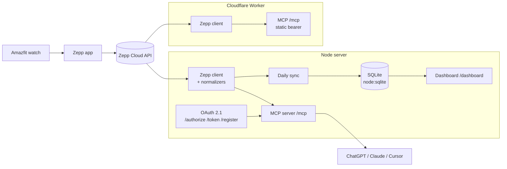

The code layout:

| Path | Contents |
|---|---|
| `src/zepp/` | Upstream client, endpoint allow-list, normalizers and the sport, exercise and muscle catalogs |
| `src/mcp/server.ts` | Tool definitions |
| `src/oauth.ts` | OAuth server |
| `src/sync/` and `src/store/` | Sync engine, SQLite schema and migrations |
| `src/dashboard/` | Server-rendered dashboard |
| `src/server-node.ts` | Node entry point |
| `src/index.ts` | Worker entry point |

## Data and privacy

- **You host it.** Health data goes only between Zepp Cloud, your server and the MCP clients you connect. There is no telemetry.
- The Node server stores synced data in `data/zepp.db` and OAuth state in `data/oauth-store.json`. Both are git-ignored. Protect them like any other health record.
- The Worker keeps no durable storage. It only caches validated responses briefly.
- The server never stores your Zepp email or password. It uses an app token that you supply and rotate.
- Route maps load tiles from OpenStreetMap, so your browser requests map tiles for the areas you ran in.

## Development

```bash
npm ci
npm run typecheck   # tsc --noEmit
npm test            # Workers (workerd) suite, then the Node suite
npm run test:node   # Node suite only
npm run dev         # wrangler dev (Worker)
npm start           # Node server
```

Other scripts:

- `npm run test:live` runs a read-only probe against your real account.
- `npm run exercises:rederive` rebuilds exercise labels in the local database.

Contributions are welcome. Please read [CONTRIBUTING.md](CONTRIBUTING.md).

## Roadmap

- [ ] Multi-user support (more than one Zepp account per server)
- [ ] Docker image and compose file
- [ ] Dashboard view for blood pressure and emotion events
- [ ] Assistant-side prompts and resources (weekly report templates)
- [ ] Automatic detection of the region host

## Acknowledgements

- [ZeppBridge](https://github.com/lingcang728/ZeppBridge) was the original inspiration. Its sport catalog data is used under the MIT License.
- [Gadgetbridge](https://codeberg.org/Freeyourgadget/Gadgetbridge) is the source of the strength exercise and muscle catalogs (AGPL-3.0-or-later).
- [OpenStreetMap](https://www.openstreetmap.org/copyright) contributors provide the route map tiles.
- The [Model Context Protocol](https://modelcontextprotocol.io) SDK.

See [THIRD_PARTY_NOTICES.md](THIRD_PARTY_NOTICES.md).

## License

[AGPL-3.0-or-later](LICENSE) © Ary Arfani and contributors. If you run a modified version as a network service, you must offer its source to the users of that service.
